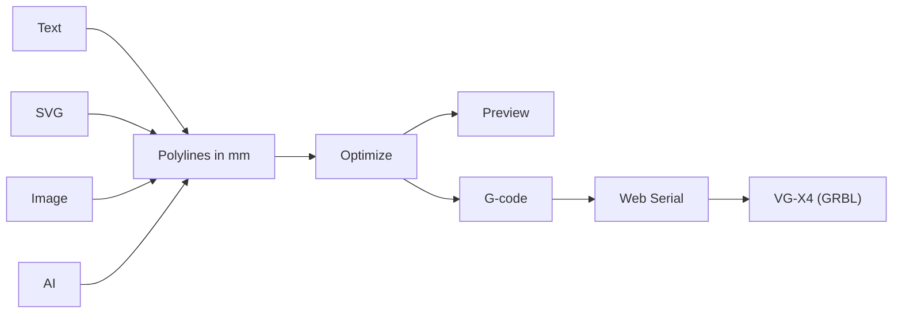

# inkbot

<p align="center">
  
</p>

<p align="center">
  <a href="https://github.com/xenofex7/inkbot/blob/main/LICENSE"></a>
  
  
  
</p>

<p align="center">
  <a href="https://xenofex7.github.io/inkbot/"><strong>xenofex7.github.io/inkbot</strong></a>
</p>

Browser app to drive the VigoTec VG-X4 pen plotter (writing robot) straight from Chrome or Edge. It talks to the machine's GRBL firmware over USB using the Web Serial API, so there is nothing to install and no server involved. Write text in single-line fonts, plot images and SVGs, and use AI with your own API key to invent drawings.

## Features

- Connect via USB, see live machine status, use a G-code console
- Pen up/down with adjustable depth, jogging, set the origin, always visible control bar
- Write text in single-line fonts (Hershey, EMS) with size, line height, alignment and paper formats (A4, A5, A6, C6/DL envelopes)
- Turn images into lines: centre lines, outlines, hatching, hatched fills
- Import SVG files and draw their paths exactly
- AI image or AI drawing (SVG) from a prompt, with OpenAI or any OpenAI-compatible server such as LiteLLM, editable prompts, your key stays in the browser
- Card designer: combine text, images, AI results and gallery drawings on one sheet, drag and resize them
- Sheet preview with run time, pause and stop, save as SVG, gallery of saved drawings
- Your own handwriting: write each character in the browser or on an iPhone (QR code, share via AirDrop), or fill in a printed or plotted template and scan a photo of it, with natural variation from letter to letter
- Backup: export and import settings, prompts, gallery and handwriting in one file (without the API key), optionally saved automatically into a folder such as iCloud Drive
- English and German interface

## Requirements

- Chrome or Edge on desktop (Web Serial is not available in Firefox or Safari)
- VigoTec VG-X4 connected via USB, with its power switch on
- Optional: API key of an AI provider for the AI features

## Usage

1. Open [xenofex7.github.io/inkbot](https://xenofex7.github.io/inkbot/) in Chrome or Edge and click "Connect plotter".
2. On the Machine page, move the pen to the top left corner of the sheet and set the origin.
3. Pick paper in the control bar, open "Design", add text, images, SVGs, AI drawings or gallery items, arrange them and click "Draw".

## Architecture



Every source is converted into polylines in millimetres first and turned into G-code only at the very end. That way text, SVGs, images and AI output share the same preview, path optimisation and plotting pipeline. The whole app is a static site that runs entirely in the browser.

Notes on the hardware and the GRBL protocol live in [`docs/`](docs/), the design system in [`DESIGN.md`](DESIGN.md).

## Development

```bash
npm ci
npm run dev
```

The app is now running at `http://localhost:5173`.

```bash
npm run check
npm run lint
npm test
npm run build
```

`npm run fonts` regenerates `src/lib/text/fonts.json` from the SVG fonts in `fonts/`.

Commit style: prefixes Add, Fix, Update, Remove, Refactor, Polish. Imperative mood.

## Credits

- [Wudstyz/VG-X4](https://github.com/Wudstyz/VG-X4) and [Morgulisan/VGX4-Control](https://github.com/Morgulisan/VGX4-Control) showed that the VG-X4 can be driven directly over GRBL.
- Fonts: Hershey and EMS single-line fonts, see [`THIRD_PARTY_NOTICES.md`](THIRD_PARTY_NOTICES.md).

Not affiliated with VigoTec.

## License

MIT, see [LICENSE](LICENSE).
