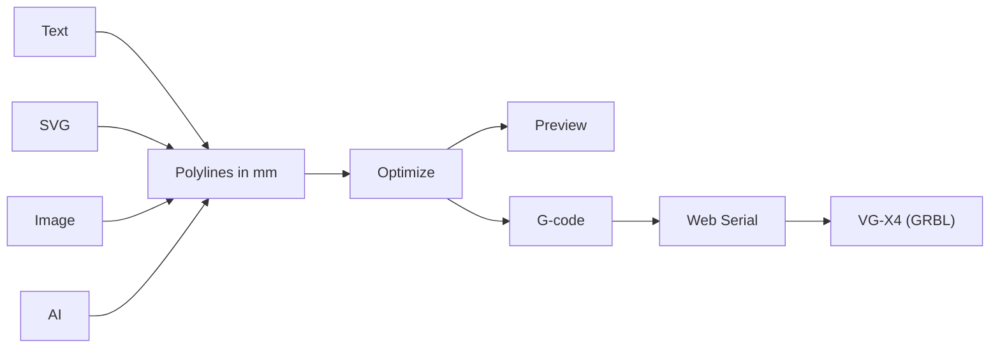

# inkbot

  

Browser app to drive the VigoTec VG-X4 pen plotter (writing robot) straight from Chrome or Edge. It talks to the machine's GRBL firmware over USB using the Web Serial API, so there is nothing to install and no server involved. Write text in single-line fonts, plot SVGs and images, and use AI with your own API key to invent drawings or turn photos into line art.

Status: planning. No code yet, development starts once the machine is assembled.

## Features

Planned for the first version:

- Connect via USB, check the firmware, show live machine status and a console
- Jog the pen, test pen up/down, set the origin
- Write text in single-line fonts with size, line spacing, margins and paper formats (A4, A5, A6, C6/DL envelopes)
- Import, scale and position SVGs
- Preview paths with estimated run time, then start, pause and stop with live speed override

Planned later:

- Turn images into lines (contours, hatching, single continuous line)
- AI: generate line art from a prompt or turn a photo into a simple drawing, using your own API key that never leaves the browser
- Templates for greeting cards, envelopes from a CSV address list and place cards

## Requirements

- Chrome or Edge on desktop (Web Serial is not available in Firefox or Safari)
- VigoTec VG-X4 connected via USB
- Optional: API key of an AI provider for the AI features

## Architecture

Every source is converted into polylines in millimetres first and turned into G-code only at the very end. That way text, SVGs, images and AI output share the same preview, path optimisation and plotting pipeline. The whole app is a static site that runs entirely in the browser.

Notes on the hardware and the GRBL protocol live in [`docs/`](docs/).

## Credits

- [Wudstyz/VG-X4](https://github.com/Wudstyz/VG-X4) and [Morgulisan/VGX4-Control](https://github.com/Morgulisan/VGX4-Control) showed that the VG-X4 can be driven directly over GRBL.

Not affiliated with VigoTec.
